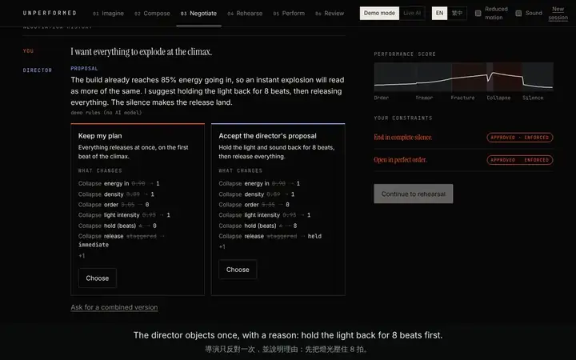
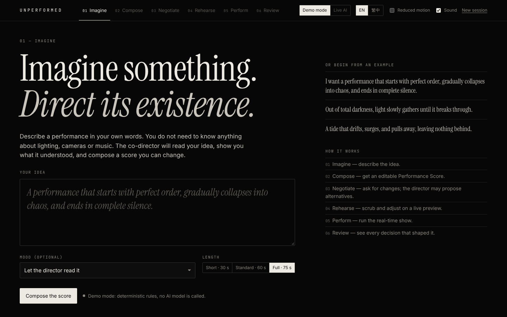
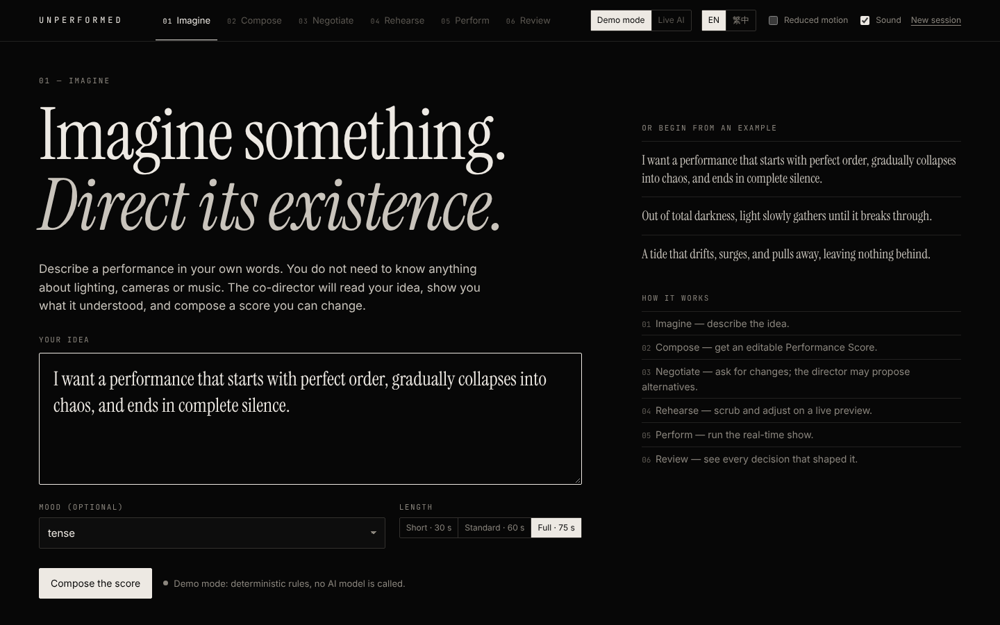
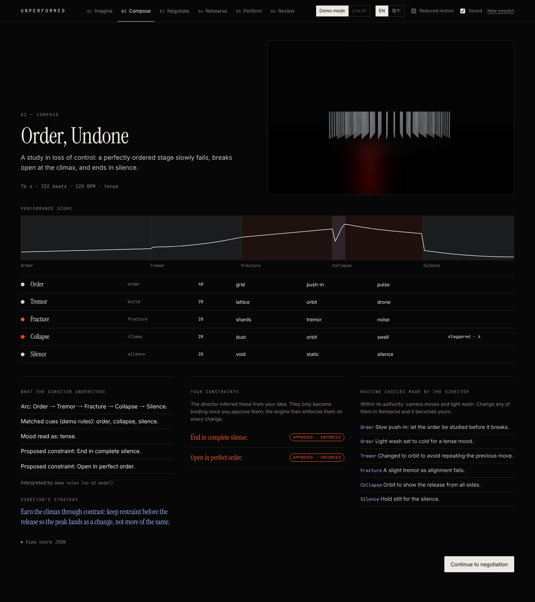
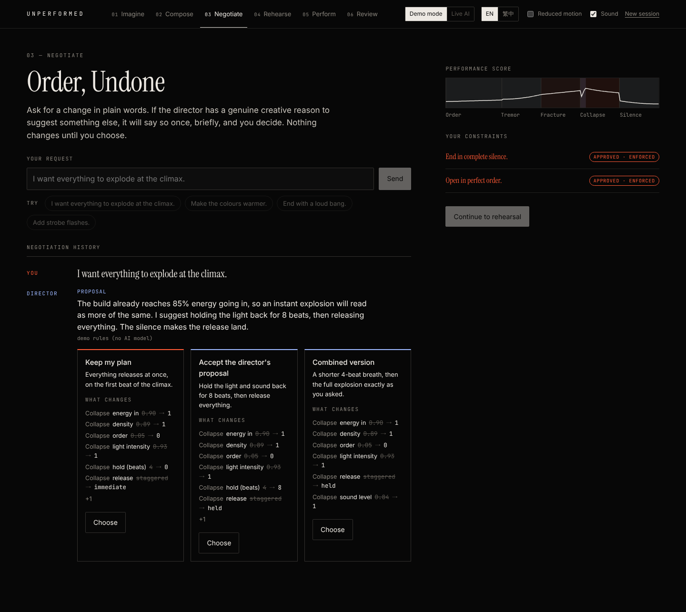
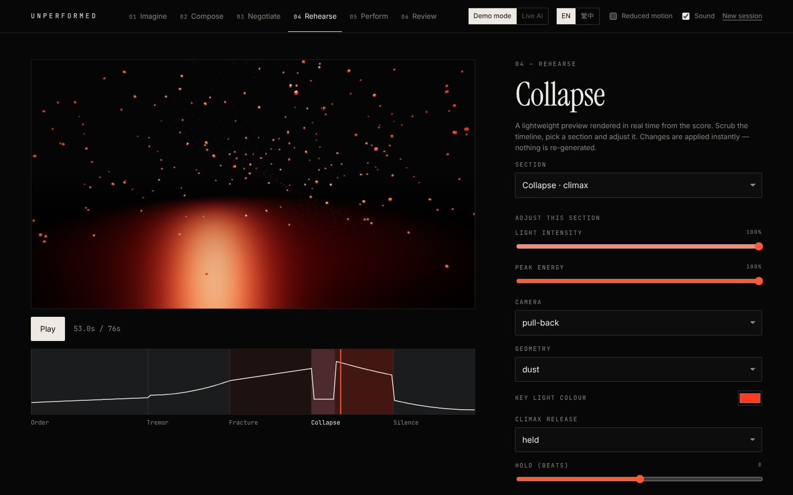
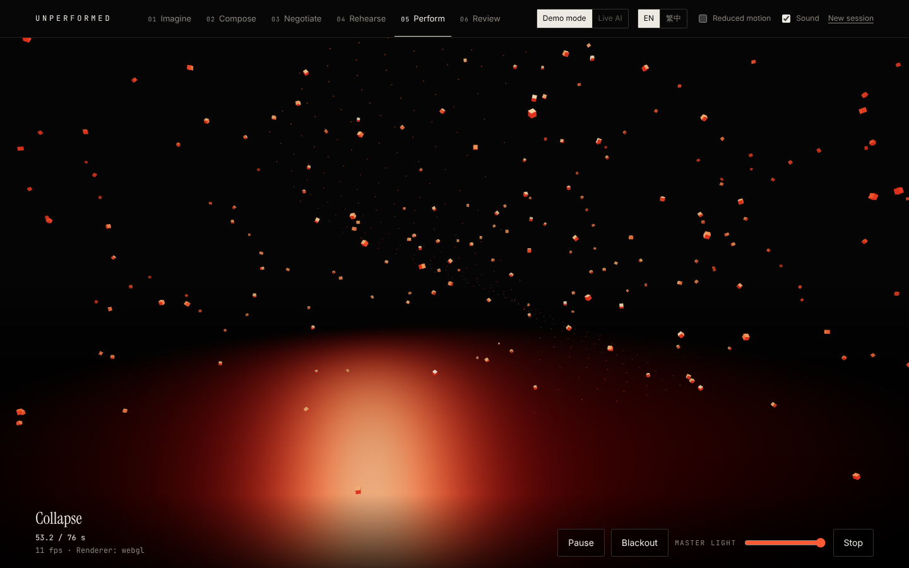
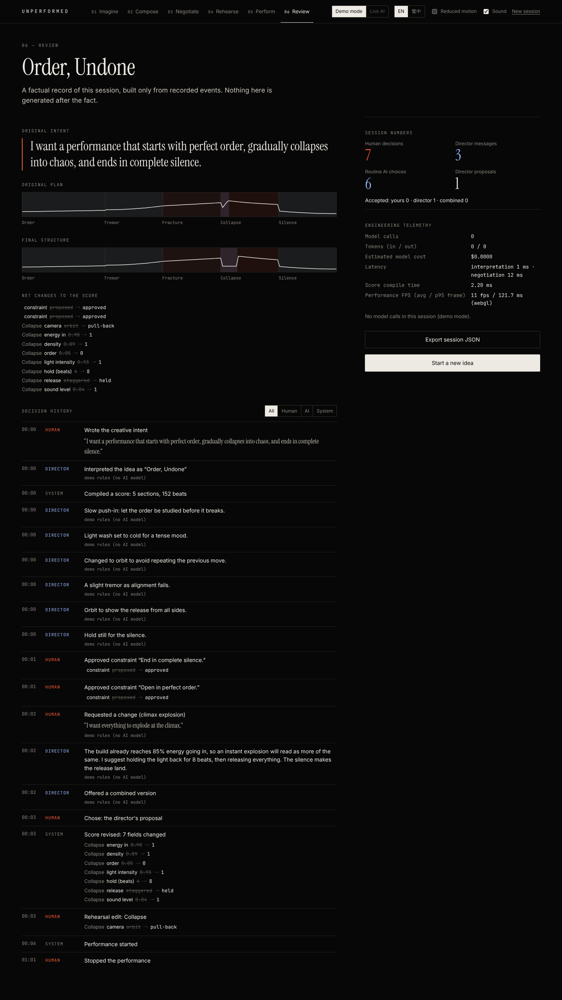
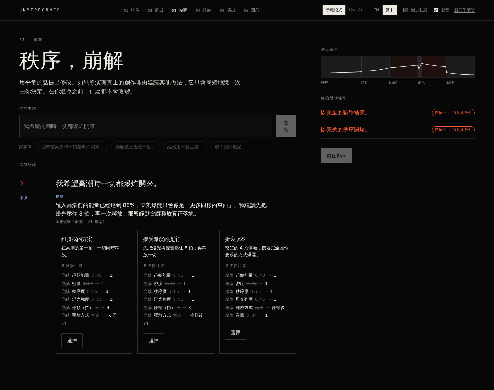

<div align="center">

# UNPERFORMED

**Imagine something. Direct its existence.**

An open-source studio where a person and an AI co-director turn an idea into a
real-time audiovisual performance, and the person stays in charge.

English · [繁體中文](README.zh-TW.md)

[](https://github.com/joojoohappy/Unperformed/actions/workflows/ci.yml)
[](LICENSE)

<a href="assets/demo/unperformed-demo.mp4"></a>

<sub>Preview captured from the running app in demo mode. <a href="assets/demo/unperformed-demo.mp4">Watch the full demo (89 s, with sound and captions)</a>.</sub>

</div>

## What it is

You write an idea in plain language: *"A performance that starts with perfect
order, gradually collapses into chaos, and ends in complete silence."*

UNPERFORMED turns it into a **Performance Score**, a typed and validated plan of
sections, energy, light, camera, geometry and sound. An AI co-director composes
it with you. When you ask for something it believes will not work, it says so
**once, with a reason**, and offers an alternative. You decide. Then the score
plays as a real-time 3D stage with procedural sound, and you can step in while
it plays. Afterwards, a review shows exactly who decided what.

The point is not to let an AI make art for you. It is to explore what working
**with** an opinionated collaborator looks like when the boundaries of its
authority are explicit, enforced and visible.

## The workflow

| | Stage | What happens |
| --- | --- | --- |
| 1 | **Imagine** | Write the idea. Choose a mood and a length (30, 60 or 75 s), or let the director read them. |
| 2 | **Compose** | The idea becomes a validated Performance Score. The director proposes constraints ("end in complete silence"); they bind nothing until you approve them. |
| 3 | **Negotiate** | Ask for changes in your own words. Every option shows the exact field changes. Nothing changes until you choose. |
| 4 | **Rehearse** | Scrub the timeline and edit any section. Your edits are locked against the AI. |
| 5 | **Perform** | The score plays in real time (75 s by default): a 3D stage with procedural audio. Pause, black out or dim the light at any moment. |
| 6 | **Review** | A factual record built only from recorded events: decisions by actor, the score before and after, telemetry. |

<table>
  <tr>
    <td width="50%"><br><sub><b>Imagine</b>: landing page</sub></td>
    <td width="50%"><br><sub><b>Imagine</b>: writing the idea</sub></td>
  </tr>
  <tr>
    <td><br><sub><b>Compose</b>: the Performance Score</sub></td>
    <td><br><sub><b>Negotiate</b>: the climax disagreement</sub></td>
  </tr>
  <tr>
    <td><br><sub><b>Rehearse</b>: editing a section</sub></td>
    <td><br><sub><b>Perform</b>: just after the climax releases</sub></td>
  </tr>
  <tr>
    <td><br><sub><b>Review</b>: who decided what</sub></td>
    <td><br><sub>The whole studio also runs in Traditional Chinese</sub></td>
  </tr>
</table>

All screenshots are real captures of the app in demo mode. See [how the media was made](docs/en/media.md).

## The core scenario

The idea builds steadily toward a collapse. You ask: **"I want everything to
explode at the climax."**

The director notices the build already reaches 85% energy going in, so an
instant explosion would read as more of the same. It proposes **holding the
light and sound back for 8 beats, then releasing everything**, so the silence
makes the release land. You can keep your plan, take the proposal, or ask for a
**combined version** (a shorter 4-beat breath, then your full explosion).

Whatever you choose is applied by code, locked as your decision, and remembered:
ask again and the director will not repeat the objection. If a request would
break a constraint you approved ("end in complete silence"), the conflict is
shown, not resolved behind your back. A strobe request gets a safety notice, not
a debate.

## Quick start (demo mode, no credentials)

Requirements: Node.js 20 or later (22 recommended) and pnpm 10.

```bash
git clone https://github.com/joojoohappy/Unperformed.git
cd Unperformed
pnpm install
pnpm dev            # http://localhost:5173
```

Demo mode is deterministic and needs no API key. It is labelled everywhere it
appears: every message says `demo rules (no AI model)`. Add `?lang=zh-TW` for
Traditional Chinese, or `?renderer=canvas` to force the 2D renderer.

## Live AI mode (optional)

Live AI lets a Claude model interpret ideas and argue in negotiations. The key
stays in a small local service and never reaches the browser.

Requirements: Python 3.11+ and [uv](https://docs.astral.sh/uv/).

```bash
export ANTHROPIC_API_KEY=...             # never commit it; other settings are in .env.example
pnpm dev:ai                              # service on 127.0.0.1:8787
pnpm dev                                 # in another terminal
```

Switch the top bar to **Live AI**. Model output is labelled with the model id.
If a call fails, the studio says so: negotiation falls back to the rules and is
labelled "rule-based fallback", and a failed interpretation asks whether to
continue with demo rules. It never shows a rule-based answer as a model's.

Configuration and error codes: [services/ai/README.md](services/ai/README.md).
Live AI has been tested against a simulated transport only; see
[limitations](docs/en/limitations.md).

## What is AI and what is not

| Part | Demo mode | Live AI mode |
| --- | --- | --- |
| Reading the idea (Interpretation) | Deterministic rules | Claude, structured output, validated |
| Compiling the score | Deterministic compiler | Same compiler |
| Routine staging (camera moves) | Rules, labelled | Rules, labelled |
| Whether the director objects | A testable rule | The same rule; the model can phrase it and tune the hold |
| Authority, constraints, safety | Code | Code |
| Review | Built from recorded events | Same |

## How it is built

```
packages/performance-core   schema, compiler, authority, negotiation, timeline, safety (TypeScript, zod)
apps/web                    the studio (Vite, React, three.js, Web Audio)
services/ai                 optional Live AI service (FastAPI, Pydantic, Anthropic SDK)
scripts                     benchmarks and media capture
```

The timeline is a pure function of the beat, the audio clock drives the visuals,
and every change to a score goes through one authority-checked function. Read
the [architecture](docs/en/architecture.md).

## Tests and measurements

```bash
pnpm lint && pnpm typecheck
pnpm test             # core (77) and web unit tests (5)
pnpm test:e2e         # Playwright, desktop and mobile (16)
pnpm test:ai          # service: pytest (22), ruff, mypy
pnpm bench            # core timings
pnpm bench:browser    # bundle size, load, frame rate in headless Chromium
```

All of these pass at the time of writing. The tests cover the schema, the
authority policy, approve and reject flows, constraint preservation, invalid
model output, timeline replay, the rendering fallback, the session reducer, the
API contract, and the full workflow in a browser, including Live AI with a
mocked service. Measured numbers, and what they do and do not mean, are in
[evaluation](docs/en/evaluation.md).

## Documentation

| | English | 繁體中文 |
| --- | --- | --- |
| Architecture | [architecture.md](docs/en/architecture.md) | [architecture.md](docs/zh-TW/architecture.md) |
| Design decisions | [design-decisions.md](docs/en/design-decisions.md) | [design-decisions.md](docs/zh-TW/design-decisions.md) |
| Authority policy | [authority-policy.md](docs/en/authority-policy.md) | [authority-policy.md](docs/zh-TW/authority-policy.md) |
| Negotiation protocol | [negotiation-protocol.md](docs/en/negotiation-protocol.md) | [negotiation-protocol.md](docs/zh-TW/negotiation-protocol.md) |
| Performance Score | [performance-score.md](docs/en/performance-score.md) | [performance-score.md](docs/zh-TW/performance-score.md) |
| Evaluation | [evaluation.md](docs/en/evaluation.md) | [evaluation.md](docs/zh-TW/evaluation.md) |
| Limitations | [limitations.md](docs/en/limitations.md) | [limitations.md](docs/zh-TW/limitations.md) |
| Media and licensing | [media.md](docs/en/media.md) | [media.md](docs/zh-TW/media.md) |
| Roadmap | [roadmap.md](docs/en/roadmap.md) | [roadmap.md](docs/zh-TW/roadmap.md) |

## Accessibility and safety

Light modulation is capped at 2 Hz and 30% depth by the engine, below the WCAG
2.3.1 flash threshold, whatever a score says. The studio follows the system
reduced-motion setting and has its own toggle. The interface is keyboard
operable: in a performance, <kbd>Space</kbd> pauses, <kbd>B</kbd> blacks out and
<kbd>Esc</kbd> stops.

## Contributing

Contributions are welcome. Read [CONTRIBUTING.md](CONTRIBUTING.md)
([繁體中文](CONTRIBUTING.zh-TW.md)) and the [Code of Conduct](CODE_OF_CONDUCT.md).
Report security issues as described in [SECURITY.md](SECURITY.md).

## License

[Apache License 2.0](LICENSE). The demo media is released under the same
license; see [media and licensing](docs/en/media.md).
